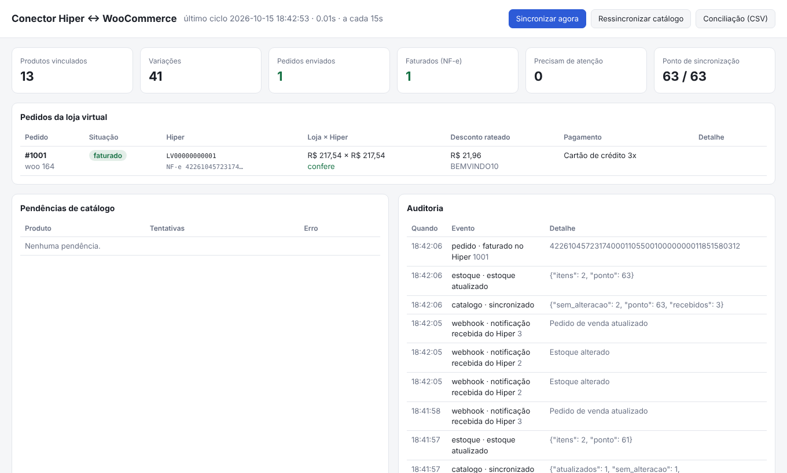
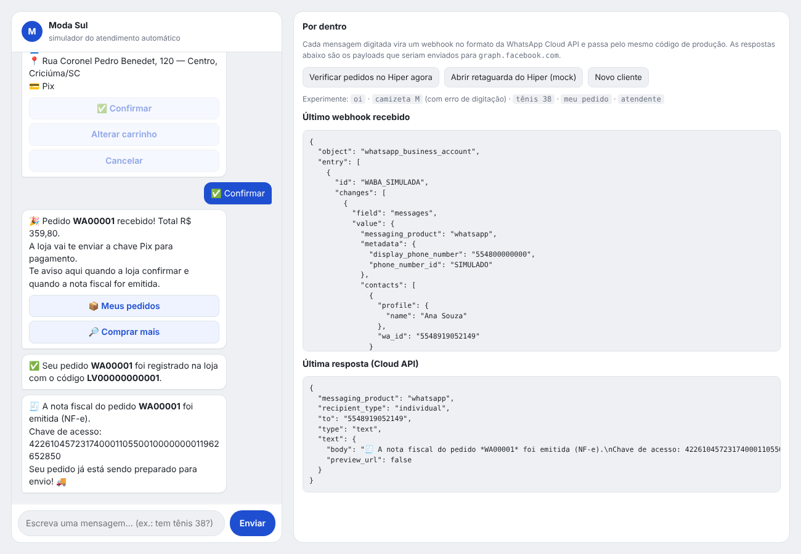
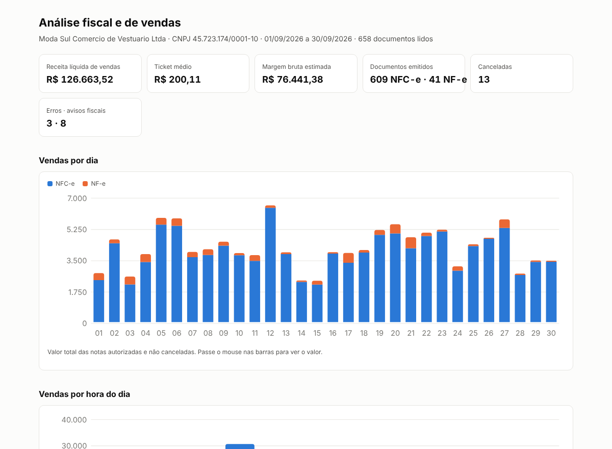
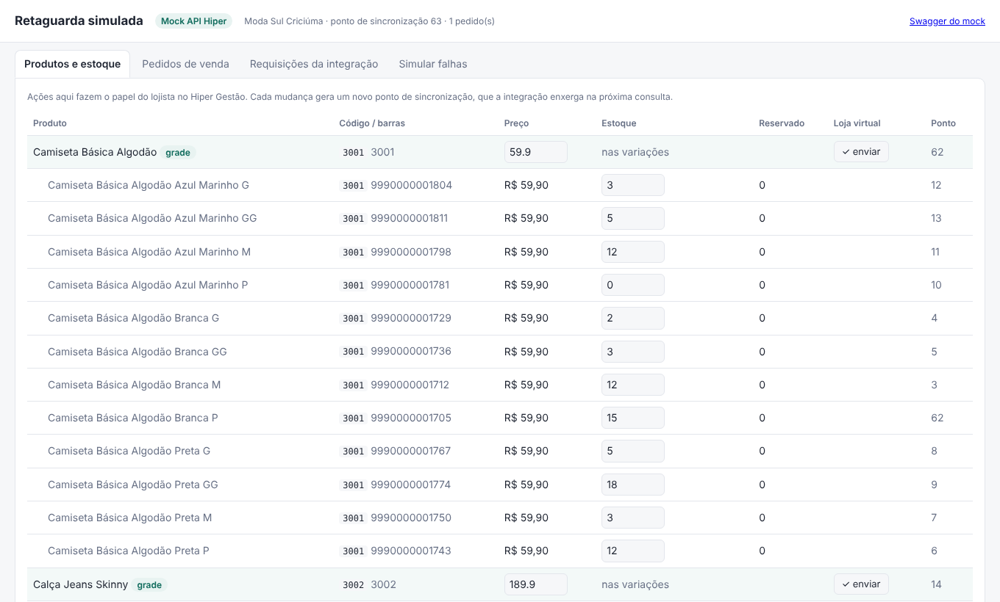
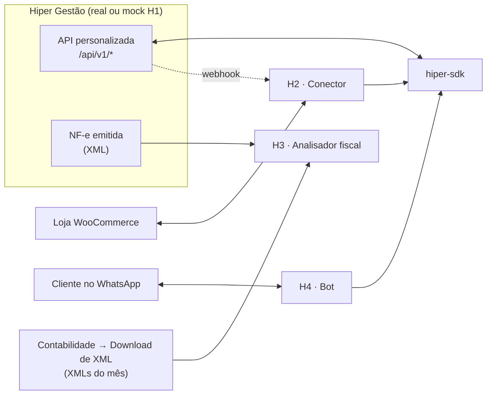

# Hiper · projetos de integração

Quatro produtos funcionais em torno do **Hiper Gestão** (ERP do pequeno varejo, grupo StoneCo), construídos sobre a
**API personalizada de e-commerce** documentada pela Hiper. Todos rodam hoje, sem conta no Hiper, contra um mock fiel
ao contrato oficial, e passam a usar a API real trocando duas variáveis de ambiente.

| Projeto | O que é | Demo |
|---|---|---|
| [**H1 · Mock da API Hiper**](h1-mock-api-hiper/) | Servidor com as mesmas rotas e campos do Swagger oficial, regras reais (ponto de sincronização, grade, reserva, marketplace em SC) e uma retaguarda simulada para agir como o lojista | `python -m mock_hiper` |
| [**H2 · Conector Hiper ↔ WooCommerce**](h2-conector-loja-virtual/) | Catálogo, estoque, pedidos, NF-e e cancelamentos sincronizados, com desconto rateado, conciliação e painel | `python -m conector demo` |
| [**H3 · Analisador de XMLs fiscais**](h3-analisador-xml-fiscal/) | Curva ABC, margem por NCM, CFOPs, canceladas e 21 checagens fiscais (inclui IBS/CBS 2026), com dashboard e PDF | `python -m analisador dashboard` |
| [**H4 · Bot de WhatsApp**](h4-bot-whatsapp/) | Consulta de preço e estoque, carrinho e pedido de venda no Hiper pelo chat; avisa quando a NF-e sai | `python -m bot demo` |

E uma base compartilhada: [**hiper-sdk**](hiper-sdk/), cliente Python da API com renovação de token, backoff em 429/5xx
e proteção contra pedido duplicado.

<table>
<tr>
<td></td>
<td></td>
</tr>
<tr>
<td></td>
<td></td>
</tr>
</table>

## Como as peças se encaixam



## Rodando tudo

Requer Python 3.11+.

```bash
git clone https://github.com/GabrielNM12/hiper-especialista && cd hiper-especialista
python -m venv .venv && source .venv/bin/activate        # Windows: .venv\Scripts\activate
pip install -r requirements.txt

cd h2-conector-loja-virtual && python -m conector demo    # loja + conector + mock do Hiper
```

Cada pasta tem seu README com o roteiro de demonstração. Para rodar a suíte inteira:

```bash
python scripts/testar_tudo.py    # 93 testes (Windows, Mac e Linux)
```

Com Docker: `docker compose up` sobe o mock do Hiper, a loja simulada, o conector, o bot e o dashboard fiscal
(portas 8000, 8100, 8200, 8300 e 8501).

## O que este repositório demonstra sobre o Hiper

- O contrato real da API, conferido no Swagger oficial e versionado em
  [`h1-mock-api-hiper/contrato`](h1-mock-api-hiper/contrato/contrato_oficial.json), com um script que avisa se a
  Hiper mudar rotas ou campos. Resumo prático em [`docs/api-hiper-guia.md`](docs/api-hiper-guia.md).
- As pegadinhas que só aparecem integrando de verdade: desconto sem campo próprio, centavos que não fecham,
  grade pai × filho, estoque reservado e negativo, cancelamento no Gestão invisível para a API, POST sem
  idempotência, marketplace obrigatório em SC.
- O lado fiscal do varejo brasileiro: NF-e × NFC-e, CFOP por destino, CSOSN × CST, ST e CEST, GTIN, e a transição
  para IBS/CBS.

## Estrutura

```
hiper-sdk/                  cliente Python da API (usado por H2 e H4)
h1-mock-api-hiper/          mock + contrato oficial + coleção Postman
h2-conector-loja-virtual/   conector + mock WooCommerce + painel
h3-analisador-xml-fiscal/   analisador + dashboard + relatório de exemplo
h4-bot-whatsapp/            bot + simulador de chat
docs/                       guia da API e capturas de tela
```

Dados de demonstração são fictícios (loja "Moda Sul", Criciúma/SC). Os XMLs gerados são de homologação e não têm
valor fiscal. Projetos independentes, sem vínculo com a Hiper ou a StoneCo.
